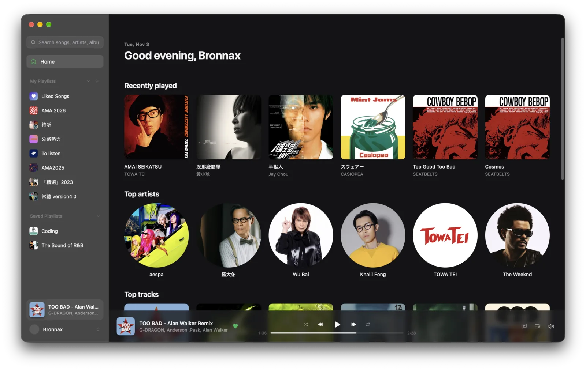
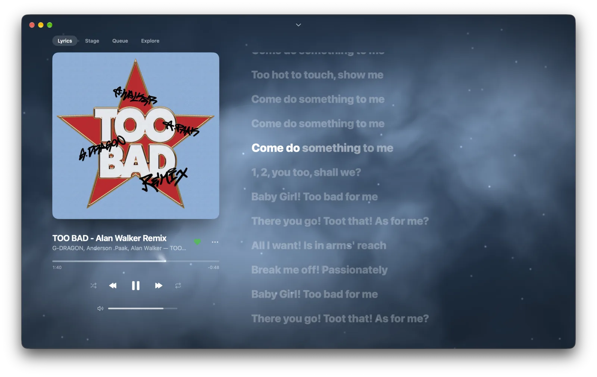
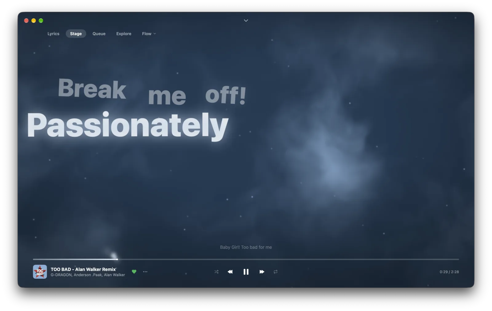
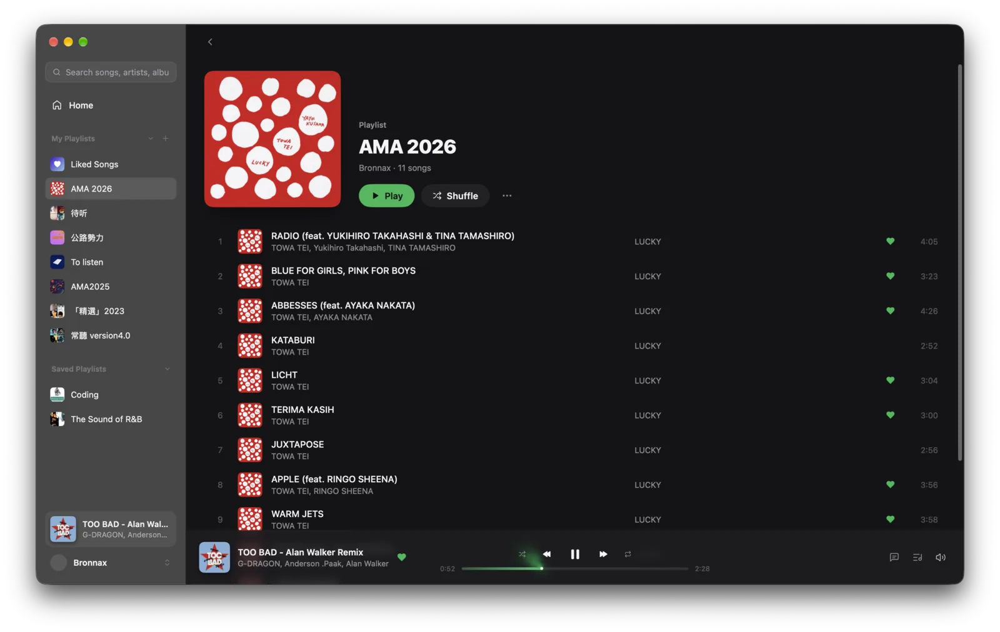

[English](README.md) | [简体中文](README.zh-CN.md) | [繁體中文](README.zh-TW.md) | 日本語

# MyGoify

[](LICENSE)
[](https://github.com/egoist/mygo)
[](https://github.com/egoist/mygo-cloudmusic)
[](https://github.com/aronnaxlin/mygoify/actions/workflows/ci.yml)
[-brightgreen.svg)](#インストール)
[](https://developer.spotify.com/documentation/soloist)

MyGoify は、Go 言語と [MyGo](https://github.com/egoist/mygo) で構築された、音楽再生専用の軽量かつネイティブなサードパーティ製 Spotify デスクトップクライアントです。

ユーザーインターフェースと再生エンジンを完全に分離したアーキテクチャを採用しており、再生処理は Spotify 公式のヘッドレスプレイヤー **Soloist** がユーザーサービスとしてバックグラウンドで担います。この設計により、公式クライアント（約 900 MB）と比較して極めて低いメモリ消費量を実現しています。Linux 環境における実測値では、再生中・ウィンドウ表示時の UI プロセスが約 110 MB、常駐する Soloist サービスが約 60 MB（PSS）です。UI ウィンドウを閉じても、バックグラウンドで音楽を途切れることなく再生し続けることができます。

**インターフェースは egoist 氏の作品です。** デザイン、再生中画面、歌詞ステージ、各種ビジュアルエフェクトは、MyGoify のフォーク元である [egoist/mygo-cloudmusic](https://github.com/egoist/mygo-cloudmusic) によるものです。MyGoify はそれを Spotify に対応させました：Soloist による再生、Web API によるライブラリの読み込み、Spotify 向けの歌詞ソース、4 つの表示言語、そして Linux 対応です。egoist 氏に心より感謝申し上げます。

> **免責事項**：本プロジェクトは独立したオープンソースプロジェクトであり、Spotify AB との提携、承認、または公式な関係はありません。Spotify は Spotify AB の登録商標です。

<table>
<tr>
<td></td>
<td></td>
</tr>
<tr>
<td></td>
<td></td>
</tr>
</table>

---

## 主な機能

- **音楽ライブラリ**：お気に入りの曲、作成およびフォロー中のプレイリスト、最近再生した曲、よく聴くアーティストや人気トラック。
- **プレイリスト管理**：プレイリストの閲覧、新規作成、名前変更、楽曲の追加・削除（※自身が作成したプレイリストのみ）。
- **楽曲検索**：楽曲、アルバム、アーティスト、プレイリストの検索、ローカル検索履歴。
- **歌詞表示**：リアルタイム同期歌詞、文字単位のハイライト、歌詞翻訳に対応。[LRCLIB](https://lrclib.net/) による歌詞提供に加え、設定画面でオン/オフ可能なサードパーティ歌詞ソースにも対応しています。
- **再生コントロール**：再生/一時停止、曲送り/曲戻し、シーク操作、音量調整、シャッフル再生、リピート再生。
- **再生キュー**：Soloist の再生状態を直接反映したキュー表示、カバーアートウォール、「キューに追加」機能。
- **デスクトップ環境連携**：グローバルメディアキー、Linux の MPRIS 制御、macOS Now Playing、システムトレイ格納（トレイ最小化後もバックグラウンド再生を継続）。
- **オーディオビジュアライザー**：プレイヤーバーの波形スペクトラム表示、macOS ノッチ部の音柱インジケーター、低音に合わせて揺らめく背景スモークエフェクト。Soloist 自身の音声ストリームのみからメモリ上でリアルタイム解析を行い（Linux では PipeWire で Soloist のストリームのみをキャプチャし、macOS では process tap で Soloist プロセスのみをリッスン）、他のアプリケーションの音声を拾うことはありません。また音声データの録音・保存・外部へのエクスポートも一切行いません。
- **多言語インターフェース**：多言語対応（対応予定）。

---

## 動作に必要な環境

1. **Spotify Premium アカウント**：Spotify Connect および Soloist による再生に必要です。
2. **Spotify Developer アプリケーション**：[Spotify Developer Dashboard](https://developer.spotify.com/dashboard) でアプリを作成し、Client ID を取得してください。Redirect URI には以下を設定します：

   ```text
   http://127.0.0.1:45231/callback
   ```

3. **Soloist API Key**：[Soloist 公式ドキュメント](https://developer.spotify.com/documentation/soloist) の手順に従い、Spotify Developer Dashboard にて取得してください。

MyGoify の初回起動時には設定ウィザードが表示され、アプリ作成、ブラウザログイン、Soloist のダウンロード、API key の入力、同一ネットワーク内での初回デバイスペアリングまでをステップごとに案内します。

---

## インストール

### ビルド済みバイナリ

初回正式リリース後に以下のパッケージが提供されます：

- **Linux**：`install.sh` を同梱した `.tar.gz` アーカイブ。現在のユーザーの `~/.local` にインストールされ、自動更新にも対応します。
- **macOS (Apple Silicon)**：`.dmg` ディスクイメージ。本プロジェクトは Apple Developer ID を持たないため、App はアドホック署名で公証されていません。そのため macOS で次の確認が必要です：
  1. MyGoify を「アプリケーション」にドラッグして開きます。「MyGoify にマルウェアが含まれていないことを検証できませんでした」と表示されたら**完了**をクリックします。
  2. **システム設定 → プライバシーとセキュリティ**を開き、下にスクロールして MyGoify の横の**このまま開く**をクリックし、パスワードまたは Touch ID で確認します。
  3. 初回起動時、MyGoify によるキーチェーン項目の使用を許可し（パスワードを入力して**常に許可**を選択）、初回再生時に録音を許可します。ビジュアライザーは Soloist の音声だけをメモリ上で解析します。

  バージョンごとにアドホック署名が変わるため、新しいバージョンを手動でインストールした後はこの 3 つの確認がもう一度必要です。アプリ内アップデートで更新した場合は Gatekeeper の確認は不要ですが、キーチェーンのパスワード入力はもう一度必要です。

### ソースコードからのビルド

Go ツールチェーンを用いてソースコードから直接ビルド・実行することも可能です：

- 必要環境：**Go 1.27+**。

```sh
# リポジトリのクローン
git clone https://github.com/aronnaxlin/mygoify.git
cd mygoify

# 開発モードで実行
go tool mygo dev

# テストの実行
go test ./internal/...

# 本番バイナリのビルド
go tool mygo build
```

---

## 音質とロスレス再生の設定

Spotify は再生デバイスごとにストリーミング音質の設定を記憶します。

ロスレス音質（最大約 1.3 Mbps）を有効にする手順：

1. MyGoify で任意の音楽の再生を開始します。
2. スマートフォンまたは PC で公式 Spotify アプリを開きます。
3. **デバイス** アイコン（Spotify Connect）をタップし、**MyGoify** を選択して、ストリーミング音質を **ロスレス（Lossless）** に切り替えます。
4. この設定は一度行うだけで完了します（※Spotify Web プレイヤーからはデバイスの音質設定を変更できません）。

デフォルトの初期音質は約 160 kbps（高音質）です。

---

## 既知の制限事項

- **Developer Mode Web API の制限**：Spotify 公式 Web API の開発者モード仕様により、各カテゴリの検索結果は 1 ページあたり最大 10 件までに制限されています（ページ送りで追加読み込み可能）。また、他のユーザーが作成したプレイリスト（Spotify 公式の Daily Mix などの自動生成プレイリストを含む）はトラック一覧を取得できません（プレイリスト全体のコンテキスト再生は可能です）。アーティストページの人気楽曲は検索 API を組み合わせて生成しています。
- **Soloist のプロセス引数**：Soloist は現時点でコマンドライン引数（`-k`）経由でのみ API key を受け付けます。そのため、同一マシン上の他のローカルユーザーから `ps` コマンドや `/proc` 経由で key が確認できてしまう場合があります。マルチユーザー環境の Linux では、`/proc` を `hidepid=2` で再マウントすることでプロセス引数の閲覧を制限できます。
- **音楽専用**：ポッドキャストおよびオーディオブックには対応していません。

---

## ロードマップ

- **v1.0.0（初回正式リリース）**：メモリおよびアイドル時 CPU 予算の検証、自動パッケージングおよび自動更新の検証。
- **v1.1.0+**：
  - 軽量バックグラウンド常駐エージェント（`mygo-spotify-agent`）：ウィンドウを閉じた際に UI プロセスを完全終了し、エージェントが MPRIS / Now Playing を継続（常驻メモリ ≤ 80 MB）。
  - おすすめプレイリストのサポート（daylist、Discover Weekly 等）。
  - Spotify Connect デバイス切り替え機能。
  - Omarchy テーマ連動および Waybar ステータスバーモジュール例の提供。
  - Pure-Go 実装の予備再生バックエンド（`go-librespot`）による対応環境の拡張。

---

## 謝辞

- [egoist/mygo-cloudmusic](https://github.com/egoist/mygo-cloudmusic) — オリジナル UI コードベース、インタラクション設計、インスピレーション。
- [MyGo](https://github.com/egoist/mygo) — Go 向けネイティブデスクトップアプリケーションフレームワークおよび UI エンジン。
- [Spotify Soloist](https://developer.spotify.com/documentation/soloist) — 公式ヘッドレス再生エンジン。
- [LRCLIB](https://lrclib.net/) — オープンソースの同期歌詞配信サービス。
- [Lyricify Lyrics Helper](https://github.com/WXRIW/Lyricify-Lyrics-Helper) — インターフェース署名実装の参考（Apache-2.0 ライセンス）。

---

## ライセンス

本プロジェクトは [GNU Affero General Public License v3.0 (AGPL-3.0)](LICENSE) のもとで公開されています。
