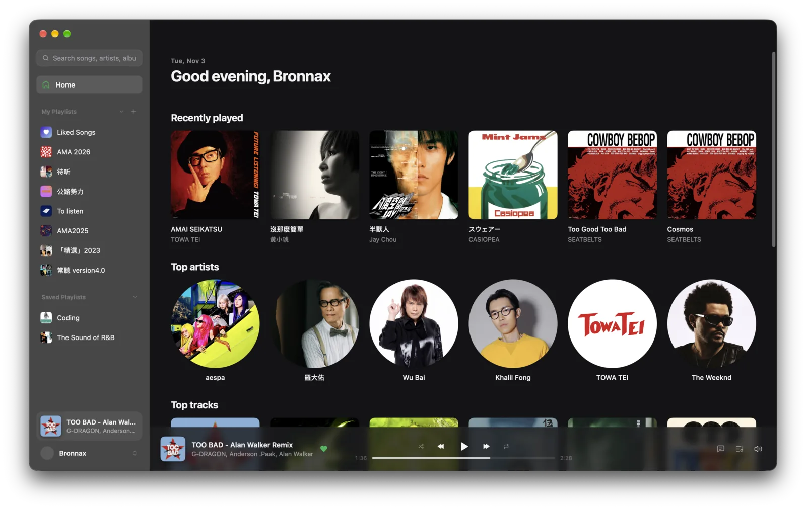
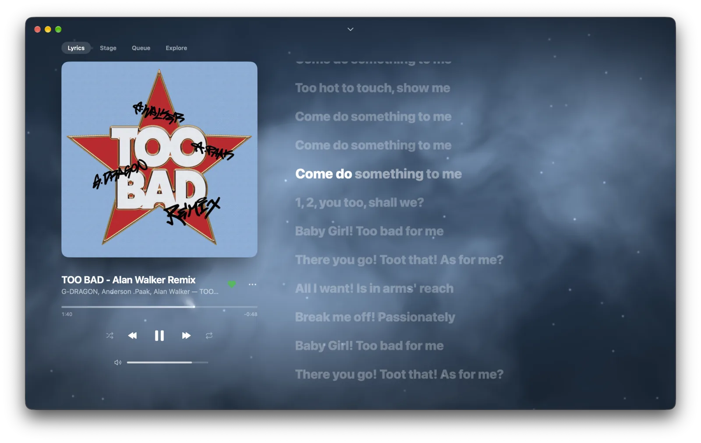
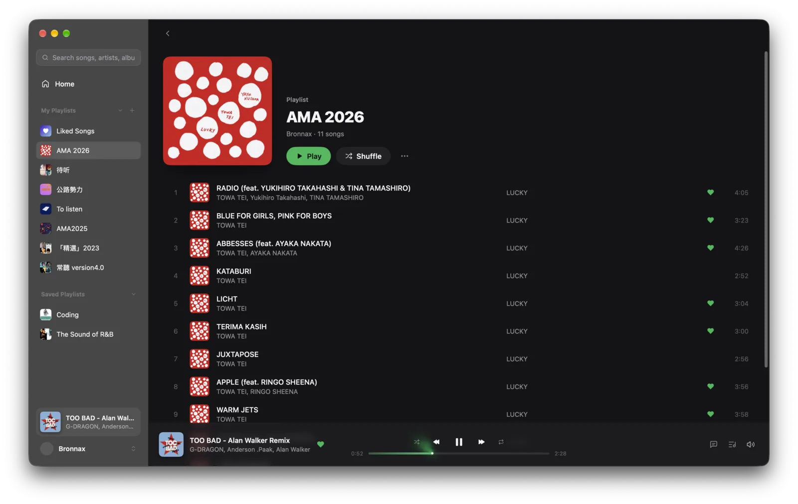

[English](README.md) | 简体中文 | [繁體中文](README.zh-TW.md) | [日本語](README.ja.md)

# MyGoify

[](LICENSE)
[](https://github.com/egoist/mygo)
[](https://github.com/egoist/mygo-cloudmusic)
[](https://github.com/aronnaxlin/mygoify/actions/workflows/ci.yml)
[-brightgreen.svg)](#安装说明)
[](https://developer.spotify.com/documentation/soloist)

MyGoify 是一个用 Go 和 [MyGo](https://github.com/egoist/mygo) 编写的原生轻量第三方 Spotify 桌面客户端，专注于纯粹的音乐体验。

应用架构将界面展示与播放引擎完全分离：播放交由 Spotify 官方的无头播放器 **Soloist**，作为独立的用户级服务在后台运行。这种设计带来了极低的内存占用——在 Linux 上窗口打开时，界面进程实测约 110 MB，后台常驻的 Soloist 服务约 60 MB（PSS，正在播放时）（相比之下官方桌面客户端约 900 MB）。关闭界面窗口后，音乐仍可在后台平稳播放。

**界面是 egoist 的作品。** 界面设计、正在播放页、律动舞台和各种视觉效果，都来自 MyGoify 所分叉的 [egoist/mygo-cloudmusic](https://github.com/egoist/mygo-cloudmusic)。MyGoify 做的是把它适配到 Spotify：用 Soloist 播放、用 Web API 读取你的曲库、换成适合 Spotify 的歌词来源，并加上四种界面语言和 Linux 支持。衷心感谢 egoist。

> **免责声明**：本项目为独立开源项目，与 Spotify AB 无任何官方关联。Spotify 是 Spotify AB 的注册商标。

<table>
<tr>
<td></td>
<td></td>
</tr>
<tr>
<td></td>
<td></td>
</tr>
</table>

---

## 功能特性

- **音乐曲库**：已点赞歌曲、自建与收藏的歌单、最近播放、常听艺人与曲目。
- **歌单管理**：浏览歌单，支持创建新歌单、重命名、添加或移除曲目（仅限自建歌单）。
- **音乐搜索**：搜索单曲、专辑、艺人与歌单，支持本地搜索历史记录。把专辑、艺人或歌单的 Spotify 链接贴进搜索框，可以直接打开。
- **歌词显示**：支持逐行同步歌词、逐字高亮时间与歌词翻译。数据来自 [LRCLIB](https://lrclib.net/) 与可选的第三方歌词源（可在设置中随时启用或关闭）。
- **播放控制**：播放/暂停、上一曲/下一曲、进度拖动（Seek）、音量调节、随机播放与循环模式。
- **播放队列**：直接与 Soloist 同步的队列视图，提供封面墙与“加入队列”功能。
- **桌面集成**：全局媒体快捷键、Linux 下的 MPRIS 媒体控制、macOS Now Playing 集成，以及系统托盘支持（可最小化至托盘并继续播放）。
- **音频可视化**：播放条动态频谱、macOS 刘海音柱指示与随低音起伏的背景雾气动效；频谱直接从 Soloist 自身的音频流在内存中实时计算（Linux 上通过 PipeWire 只捕获 Soloist 的音频流，macOS 上使用 process tap 只监听 Soloist 进程），不会捕获其他应用的声音，也绝不录制、持久化或导出音频数据。
- **电台**：在歌曲菜单里开始这首歌的电台（从这首歌开始播），或在艺人页开始艺人电台；首页提供你最常听的艺人和歌曲的电台。电台经 Soloist 播放，Spotify 限流时也能用。
- **为你推荐**：Discover Weekly、Daily Mix、daylist、艺人电台歌单显示在首页，带官方名字和封面；在任何设备上播放过、或把链接贴进搜索框后就会出现。Web API 不列出这些歌单，所以 MyGoify 用这种方式找到它们。
- **界面语言**：English、简体中文、繁體中文、日本語，默认跟随系统。

---

## 使用前提

1. **Spotify Premium 账户**：使用 Spotify Connect 与 Soloist 播放所必需。
2. **Spotify 开发者应用**：在 [Spotify 开发者后台](https://developer.spotify.com/dashboard) 创建应用以获取 Client ID，并将 Redirect URI（回调地址）填写为：

   ```text
   http://127.0.0.1:45231/callback
   ```

3. **Soloist API Key**：在 Spotify 开发者后台按照 [Soloist 官方文档](https://developer.spotify.com/documentation/soloist) 的说明获取。

MyGoify 首次启动时会弹出引导页，带你逐步完成：创建应用、浏览器登录、下载 Soloist、填入 API key 以及完成首次局域网设备配对。

---

## 安装说明

### 预编译版本

在 [Releases](https://github.com/aronnaxlin/mygoify/releases/latest) 下载最新版本，安装后 App 会自动更新。

- **Linux**：提供 `.tar.gz` 压缩包，内置 `install.sh` 脚本，解压运行即可安装至当前用户的 `~/.local` 目录下并支持自更新。
- **macOS（Apple Silicon）**：提供 `.dmg` 镜像安装包。本项目没有 Apple Developer ID，App 使用 ad-hoc 签名、未经公证，所以 macOS 会要求你确认：
  1. 把 MyGoify 拖进"应用程序"后打开。系统提示"无法验证 MyGoify 不包含恶意软件"，点**完成**。
  2. 打开**系统设置 → 隐私与安全性**，拉到下方，在 MyGoify 旁点**仍要打开**，再用密码或触控 ID 确认。
  3. 第一次启动时，允许 MyGoify 使用钥匙串中的项目（输入密码并选**始终允许**）；第一次播放时，允许录音：可视化只在内存里分析 Soloist 的声音。

  每个版本的 ad-hoc 签名都不同，所以手动装上新版本后，这三步需要再确认一次。用应用内更新升级时不会再经过 Gatekeeper，但钥匙串仍需再输一次密码。不想再被钥匙串询问，可以在**设置 → 账户 → 登录信息存放在**里选**本地文件**：登录信息和 Soloist 的 key 会存在只有你的账号能读的文件里。

### 从源码构建

你也可以直接使用 Go 工具链从源码编译运行：

- 环境要求：**Go 1.27+**。

```sh
# 克隆仓库
git clone https://github.com/aronnaxlin/mygoify.git
cd mygoify

# 以开发模式运行
go tool mygo dev

# 运行内部测试
go test ./internal/...

# 构建正式版本
go tool mygo build
```

---

## 音质与无损设置

Spotify 会按设备单独记住播放音质偏好。

如需开启无损音质（最高约 1.3 Mbps）：

1. 在 MyGoify 中开始播放任意音乐。
2. 在手机或电脑上打开官方 Spotify 客户端。
3. 点击**设备列表**图标（Spotify Connect），选中 **MyGoify (你的电脑名)**，将流媒体音质切换为**无损（Lossless）**。
4. 此设置只需修改一次，后续在 MyGoify 中播放会自动保持无损音质（注意：Spotify 网页版不支持调整设备音质）。

默认初始音质约为 160 kbps（High）。

---

## 已知限制

- **开发模式 Web API 配额限制**：受 Spotify 官方开发模式 API 的策略限制，搜索每类最多展示 10 条结果（可通过翻页加载更多）；他人的歌单（包括 Spotify 官方生成的 Daily Mix 等个性化歌单）无法通过 API 获取曲目列表，但可以按歌单整体发起播放；艺人页的“热门单曲”由搜索接口组合拼出。Spotify 为你生成的歌单无法列出，要先播放过或贴过链接，才会出现在“为你推荐”里。
- **Soloist 进程参数安全性**：Soloist 目前仅支持通过命令行参数（`-k`）接收 API key。因此在同台机器上，其他系统用户通过 `ps` 或 `/proc` 可以查看到该参数。在多用户 Linux 机器上，可通过挂载 `hidepid=2` 的 `/proc` 来隐藏进程参数。
- **仅限音乐**：不支持播客（Podcast）与有声书。

---

## 路线图规划

- **v1.0.0**：首个正式版（2026-11-03）。
- **v1.1.0**：电台与为你推荐（2026-11-08）。
- **接下来**：
  - 轻量后台常驻进程（`mygo-spotify-agent`）：关窗后界面彻底退出，由 agent 继续提供 MPRIS / Now Playing 支持，内存常驻 ≤ 80 MB。
  - Spotify Connect 设备切换。
  - Omarchy 主题跟随与 Waybar 状态栏模块示例。
  - 纯 Go 编写的备用播放后端（`go-librespot`），扩展对 Intel Mac 等更多平台的支持。

---

## 致谢

- [egoist/mygo-cloudmusic](https://github.com/egoist/mygo-cloudmusic) — 原版 UI 代码仓库、交互设计与灵感来源。
- [MyGo](https://github.com/egoist/mygo) — Go 原生桌面应用框架与渲染引擎。
- [Spotify Soloist](https://developer.spotify.com/documentation/soloist) — 官方无头播放后端。
- [LRCLIB](https://lrclib.net/) — 开放的逐行歌词服务。
- [Lyricify Lyrics Helper](https://github.com/WXRIW/Lyricify-Lyrics-Helper) — 接口签名实现的参考借鉴（Apache-2.0 协议）。

---

## 许可证

本项目基于 [GNU Affero General Public License v3.0 (AGPL-3.0)](LICENSE) 协议开源。
